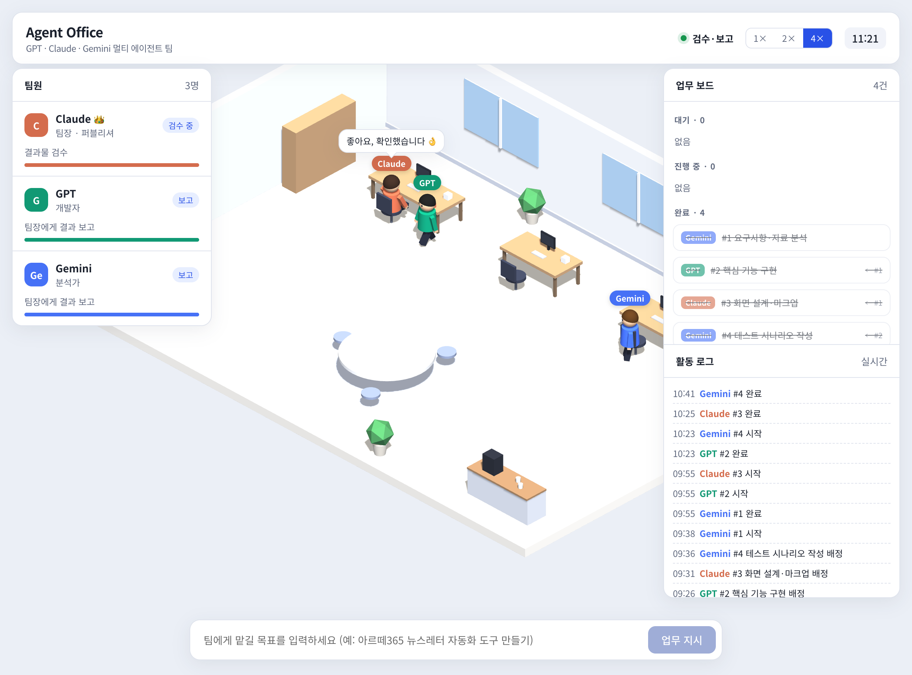

# 🏢 Agent Office — 멀티 에이전트 협업 오피스 (GPT · Claude · Gemini)



> **Agent Office**는 최신 주요 파운데이션 모델(**Anthropic Claude**, **OpenAI GPT**, **Google Gemini**)을 하나의 팀으로 조직화하여 복잡한 목표를 스스로 분해하고, 의존 관계에 따라 병렬로 협업하며, 최종 검수 보고서까지 완성하는 **지능형 멀티 에이전트 워크스페이스**입니다.
> 
> Three.js 기반 3D 가상 오피스 웹 환경을 통해 AI 에이전트들이 회의하고, 각자의 책상에서 작업하고, 보고서를 제출하는 과정을 실시간 애니메이션으로 직관적으로 관제할 수 있습니다.

---

## 🌟 주요 특징 (Key Features)

### 1. 🤝 이종 LLM 기반의 유기적 팀 협업
- **역할 특화 배정**: 
  - **Claude (팀장 겸 퍼블리셔)**: 업무 분해·지시, 최종 통합 검수, 마크업 및 문서화 총괄
  - **GPT (개발자)**: 핵심 비즈니스 로직, 코드 구현, 리팩터링 및 자동화 스크립트 작성
  - **Gemini (분석가)**: 방대한 컨텍스트 처리 능력을 바탕으로 자료 리서치, 대용량 문서 분석 및 요약
- **DAG(방향성 비순환 그래프) 의존성 스케줄링**: 
  - 서로 독립적인 태스크는 동시에 병렬 수행하고, 선행 작업이 필요한 태스크는 결과물이 나온 후 자동 착수합니다.

### 2. 🖥️ Three.js 기반 실시간 3D 가상 오피스 UI
- **살아 숨쉬는 오피스 시각화**:
  - 팀장의 화이트보드 앞 계획 수립 애니메이션
  - 팀원들의 개인 업무 책상 착석 및 타이핑 상태 연출
  - 최종 검수 시 팀원들의 회의실/팀장석 이동 브리핑
- **반응형 듀얼 모드**: 3D 가속을 지원하지 않거나 모바일 환경인 경우 가볍고 직관적인 2D 카드 목록 모드로 자동 전환됩니다.
- **100% 로컬 독립 동작 (No External CDN)**: `Three.js`, `OrbitControls`, `marked`, `DOMPurify` 등 프론트엔드 핵심 의존성을 `web/vendor`에 내장하여 폐쇄망이나 불안정한 네트워크에서도 끊김 없이 작동합니다.

### 3. 📱 무선 LAN 접속 & 모바일 관제
- 같은 Wi-Fi 환경에 있는 스마트폰이나 태블릿에서 터미널에 자동 생성되는 **QR 코드 스캔**만으로 손쉽게 접속 가능 (`--lan`).
- 안전한 토큰 기반 접속 키(`ACCESS_KEY`) 인증 시스템 내장.

### 4. 🧪 API 키 없이 테스트 가능한 모의 실행 (Mock Mode)
- 각 사의 API 키가 없어도 전체 오피스 라이프사이클과 애니메이션, 보고서 생성 흐름을 검증할 수 있는 모의 시뮬레이션 모드(`--mock`) 기본 지원.

### 5. 🚀 더블클릭 크로스 플랫폼 실행
- macOS (`start-mac.command`), Windows (`start-windows.bat`), Linux (`start-linux.sh`) 클릭 한 번으로 가상환경 구축부터 서버 실행까지 자동 완료.

---

## 🔄 아키텍처 및 워크플로우

```mermaid
flowchart TD
    User([사용자 / 웹 UI / CLI]) -->|목표 전달| Leader[팀장 에이전트: Claude]
    
    subgraph Planning [1. 계획 수립 단계]
        Leader -->|목표 분석 & 역할별 태스크 분해| Plan[JSON 실행 계획: plan.json]
    end
    
    subgraph Execution [2. 병렬 작업 수행 단계 (DAG)]
        Plan --> Task1[Task 1: Gemini 분석 리서치]
        Plan --> Task2[Task 2: GPT 코드 구현]
        Task1 -.->|선행 결과 전달| Task3[Task 3: Claude 마크업/문서화]
        Task2 -.->|선행 결과 전달| Task3
    end
    
    subgraph Review [3. 검수 및 보고서 작성]
        Task1 -->|작업물 산출| Integration[팀장 최종 검수]
        Task2 -->|작업물 산출| Integration
        Task3 -->|작업물 산출| Integration
        Integration -->|통합·보완·피드백| Report[최종 완성 보고서: report.md]
    end

    Report --> RunsArchive[(runs/ 실행 기록 아카이빙)]
    Report --> WebSocket[FastAPI WebSocket 실시간 중계]
    WebSocket --> Client([실시간 3D Web UI / 모바일 브라우저])
```

---

## 📂 프로젝트 구조

```text
.
├── agentteam/               # 멀티 에이전트 핵심 패키지
│   ├── providers.py         # Anthropic, OpenAI, Google API 및 Mock 래퍼
│   └── team.py              # 계획 분해, DAG 병렬 실행, 검수 파이프라인
├── server/                  # 웹 백엔드 (FastAPI)
│   └── app.py               # REST API (/api/*) + 실시간 WebSocket (/ws) 중계
├── web/                     # 프론트엔드 웹 오피스 UI
│   ├── index.html           # 대시보드 뷰
│   ├── app.js               # Three.js 3D 렌더링 & WebSocket 이벤트 제어
│   ├── style.css            # 반응형 및 테마 스타일
│   └── vendor/              # Three.js, marked, DOMPurify 등 오프라인 내장 라이브러리
├── scripts/                 # 실행 스크립트 모음
│   ├── launch.py            # OS 공용 대화형 실행 메뉴
│   └── bootstrap.sh         # macOS/Linux 가상환경 셋업
├── docs/
│   └── events.md            # 서버 ↔ 클라이언트 실시간 이벤트 프로토콜 명세
├── tests/                   # 단위 및 통합 테스트 (pytest)
├── runs/                    # 실행별 산출물 보관소 (plan.json, task-*.md, report.md)
├── team.toml                # 팀원 구성, 역할, AI 모델 설정 파일
├── main.py                  # CLI 실행 엔트리포인트
├── serve.py                 # 웹 서버 실행 엔트리포인트
├── start-mac.command        # macOS 더블클릭 실행기
├── start-windows.bat        # Windows 더블클릭 실행기
├── start-linux.sh           # Linux 실행 쉘 스크립트
├── requirements.txt         # 런타임 필수 의존성 목록
└── requirements-dev.txt     # 개발 및 테스트 의존성 목록
```

---

## ⚙️ 사전 준비 및 환경 설정

### 1. 요구 사항
- **Python 3.10 이상** 권장

### 2. 가상환경 및 패키지 설치
터미널에서 수동으로 설치할 경우:

```bash
# 가상환경 생성 및 활성화
python3 -m venv .venv
source .venv/bin/activate  # Windows: .venv\Scripts\activate

# 필수 패키지 설치
pip install -r requirements.txt

# 테스트 및 개발 도구 설치 (선택)
pip install -r requirements-dev.txt
```

### 3. API 키 설정 (`.env`)
프로젝트 루트의 `.env.example`을 복사하여 `.env` 파일을 생성하고 각 서비스의 API 키를 입력합니다:

```bash
cp .env.example .env
```

`.env` 파일 내용:
```env
# Anthropic Claude API Key
ANTHROPIC_API_KEY=sk-ant-...
# (선택) Anthropic 조직 단위 키인 경우에만 입력 (wrkspc_...)
ANTHROPIC_WORKSPACE_ID=

# OpenAI API Key
OPENAI_API_KEY=sk-...

# Google Gemini API Key (무료 티어는 Flash 모델만 지원)
GEMINI_API_KEY=AIzaSy...

# (선택) 모바일 LAN 접속용 고정 키 (미설정 시 서버 구동마다 임의 생성)
# ACCESS_KEY=my-secure-access-key-1234
```

> ⚠️ **주의사항**: 
> - `.env` 파일은 절대 Git 리포지토리에 커밋하지 마세요.
> - Google Gemini의 무료 티어 사용량은 `gemini-flash-latest` 등 Flash 모델에서만 정상 동작합니다.

---

## 🚦 실행 방법

### 방법 A. 더블클릭 간편 실행 (권장)
각 운영체제에 맞는 스크립트를 더블클릭(또는 터미널 실행)하면 가상환경 세팅 후 대화형 메뉴가 나타납니다:
- **macOS**: `start-mac.command`
- **Windows**: `start-windows.bat`
- **Linux**: `./start-linux.sh`

실행 후 나타나는 메뉴에서 모의 실행(키 불필요) 또는 실제 API 실행을 선택하고, 모바일 동시 접속 여부를 손쉽게 지정할 수 있습니다.

---

### 방법 B. 웹 서버 직접 실행 (`serve.py`)

#### 1) 로컬 개발 및 모의 실행 (API 키 불필요)
```bash
python serve.py --mock
```
- 브라우저 주소: `http://127.0.0.1:8000`
- `MOCK_DELAY` 기본 3초 간격으로 각 에이전트의 작업 단계가 시뮬레이션됩니다.

#### 2) 실제 AI 모델로 로컬 실행
```bash
python serve.py
```
- `.env`에 입력된 실제 API 키를 사용하여 에이전트 팀이 업무를 수행합니다.

#### 3) 모바일/같은 Wi-Fi 기기 공유 실행 (`--lan`)
```bash
python serve.py --lan
```
- 터미널에 로컬 IP 주소와 접속 키가 포함된 **QR 코드**가 출력됩니다.
- 같은 Wi-Fi에 연결된 스마트폰 카메라로 QR 코드를 촬영하면 즉시 접속하여 실시간 모니터링 및 업무 지시가 가능합니다.

---

### 방법 C. CLI 터미널 실행 (`main.py`)

웹 브라우저 없이 터미널에서 즉시 에이전트 팀을 운용할 수 있습니다.

#### 1) 팀 구성 현황 및 API 키 유효성 확인
```bash
python main.py team
```
```text
팀장: claude
- claude  [anthropic/claude-opus-5-5] (키 ✓) 팀장 겸 퍼블리셔...
- gpt     [openai/gpt-5]              (키 ✓) 개발자...
- gemini  [google/gemini-flash-latest] (키 ✓) 분석가...
```

#### 2) 전체 팀 단위 업무 수행 (`run`)
```bash
# 기본 실행
python main.py run "웹 접근성 가이드라인을 준수한 로그인 폼 컴포넌트 설계 및 구현"

# API 키 없이 모의 흐름 테스트
python main.py --mock run "반응형 랜딩 페이지 제작"

# 긴 요구사항 문서를 파일에서 직접 읽어 전달
python main.py run -f requirements.md
```
- 실행 완료 시 `runs/<생성시각>/` 디렉토리에 `plan.json`, 각 에이전트의 개별 산출물 `task-*.md`, 그리고 최종 검수본 `report.md`가 자동 저장됩니다.

#### 3) 특정 에이전트에게 1:1 개별 지시 (`ask`)
```bash
python main.py ask gpt "FastAPI WebSocket 재연결 핸들러 작성해줘"
python main.py ask gemini "2026년 프론트엔드 최신 성능 최적화 트렌드 요약"
```

---

## 👥 팀 구성 커스터마이징 (`team.toml`)

`team.toml` 파일을 수정하여 원하는 모델, 공급자(Provider), 역할을 손쉽게 재구성할 수 있습니다:

```toml
# 팀장 지정: 전체 업무 분배, 의존성 계획, 결과물 검수 및 통합 보고서 작성
[leader]
member = "claude"

# 팀원별 모델 및 역할 설정
[members.claude]
provider = "anthropic"
model = "claude-opus-5-5"
role = "팀장 겸 퍼블리셔. 업무 분해·배정, 결과 검수, HTML/CSS 마크업, 문서화"

[members.gpt]
provider = "openai"
model = "gpt-5"
role = "개발자. 코드 구현, 리팩터링, 자동화 스크립트 작성"

[members.gemini]
provider = "google"
model = "gemini-flash-latest"
role = "분석가. 긴 문서·대용량 자료 분석, 리서치, 요약"
```

---

## 📡 REST API & WebSocket 명세

자세한 이벤트 규격은 [`docs/events.md`](./docs/events.md)를 참고하세요.

### 주요 REST API 엔드포인트
| 메서드 | 엔드포인트 | 설명 |
|---|---|---|
| `GET` | `/api/team` | 현재 구성된 팀원 목록 및 역할 반환 |
| `POST` | `/api/run` | 새 업무 시작 요청 (`{"goal": "..."}`) |
| `GET` | `/api/runs` | 과거 실행 이력 목록 조회 (최신순 최대 50건) |
| `GET` | `/api/runs/{run_id}` | 특정 실행의 상세 계획, 태스크별 산출물, 최종 보고서 조회 |

### 주요 WebSocket 이벤트 (`/ws`)
- `hello`: 접속 초기 스냅샷 및 팀 구성 전달
- `run_start` / `run_end`: 업무 착수 및 전체 종료 통보
- `plan_start` / `plan`: 팀장의 계획 수립 착수 및 태스크 분해 확정
- `task_start` / `task_done`: 팀원들의 개별 업무 착수 및 산출물 완료 통보
- `review_start` / `report`: 최종 검수 진행 및 완성된 마크다운 보고서 브로드캐스트

---

## 🧪 테스트 실행

통합 테스트 및 상태 리듀서(Snapshot Reducer) 무결성 검증:

```bash
# 전체 테스트 실행
pytest -q

# 세부 로그와 함께 실행
pytest -v
```

---

## 🔒 개발 및 기여 가이드라인 (3개 AI 공통: Claude · Gemini · GPT)

- **작업 완료 시 자동화 워크플로우**:
  1. **README 작업 이력 누적**: 작업 완료 시 `README.md` 최하단에 해당 날짜(`YYYY-MM-DD`)별로 수행 내역을 간략하게 누적 기록합니다.
  2. **한글 번역 및 정리**: 작업 결과 설명, 커밋 메시지, 주요 변경 요약은 한국어로 명확히 번역/작성합니다.
  3. **클린 커밋 유지**: `.DS_Store`, `.env`, 임시 파일이 포함되지 않도록 `git status`로 철저히 검증합니다.
  4. **자동 커밋 & 동기화**: Conventional Commits 규칙에 맞추어 한글 커밋 후 `git pull --rebase` 및 `git push`를 수행합니다.
- **시크릿 관리**: `.env`, 인증 토큰, API 키 파일은 절대로 Git 스테이징 및 커밋에 포함하지 않습니다.
- **단일 소스 원칙 (Single Source of Truth)**: 프로젝트 규칙은 `CLAUDE.md`를 단일 소스로 하며, `GEMINI.md`, `AGENTS.md`, `.cursorrules`가 심볼릭 링크로 연결되어 동일하게 공유됩니다.

---

## 📄 라이선스

본 프로젝트는 내부 연구 및 프로젝트용으로 개발되었습니다.
자세한 문의나 기능 제안은 이슈 또는 팀 관리자에게 문의 바랍니다.

---

## 📝 변경 및 작업 이력

### 2026-10-14
- **상세 README.md 작성**:
  - Agent Office 멀티 에이전트 시스템 개요, 3D 가상 오피스 UI 스크린샷(`index-screenshot.png`) 연동
  - 이종 LLM(Claude·GPT·Gemini) 협업 구조, DAG 병렬 스케줄링 및 아키텍처 다이어그램(Mermaid) 추가
  - 실행 모드(원클릭 OS 런처, 웹 서버 `serve.py`, CLI `main.py`) 및 LAN/QR 모바일 연동 안내 작성
  - 팀원 커스터마이징(`team.toml`), REST API 및 WebSocket 이벤트 명세([docs/events.md](./docs/events.md)) 정리
- **3개 AI 공통 규칙 수립 및 동기화**:
  - Claude, Gemini, GPT 3개 AI 모두 작업 완료 시 `README.md` 하단 날짜별 작업 내용 누적, 한글 번역, 자동 커밋, 푸시 및 풀 자동화 규칙 추가
  - `CLAUDE.md`, `GEMINI.md`, `AGENTS.md`, `.cursorrules` 심볼릭 링크 체계 완성
- **3D 가상 오피스 그래픽 및 애니메이션 고도화 (`web/app.js`)**:
  - 에이전트 캐릭터 신체 구조 분할(엉덩이/목 피벗, 커피 모금 연출용 컵 추가)
  - 책상 모니터 듀얼 베젤 및 화면 매핑, 소품(머그컵, 마우스 등) 디테일 개선
- 개발 모드 추가: `web/` 파일을 저장하면 열린 브라우저가 자동 새로고침(정적 파일 캐시 금지), `*.py`·`team.toml` 저장 시 서버 자동 재시작 (`serve.py` 기본 켜짐, `--no-dev`로 끔)
- 작업 완료 절차 스크립트 `scripts/finish.py` 추가: 금지 파일 검사 → README 이력 누적 → 한글 커밋 → `git pull --rebase` → `git push`
- 캐릭터 시트 명세 `docs/characters.md` 추가, `docs/events.md`에 개발 모드 채널(`/__dev/ws`) 설명 추가, 개발 모드 테스트 5건 추가
- API 키·크레딧 없이 구독 로그인된 CLI(`claude -p`, `codex exec`, `gemini -p`)를 호출하는 provider 추가 (`agentteam/cli.py`, 가짜 CLI 테스트 8건)
- `team.toml` 기본값을 CLI 방식으로 변경 (Claude `opus`, Codex·Gemini `default`), `main.py team` 에 CLI 설치 상태 표시, Gemini CLI 는 `~/.npm-global` 설치 지원
- 앱 셸 리디자인: 상단 바(내비·연결·날짜·속도·경과 시계), 사이드바(대시보드·업무 보드·팀원 관리·자료실·설정, 오늘의 진행률 도넛), 오른쪽 업무 보드·활동 로그 카드, 하단 명령 바(첨부·전송), 검색 팔레트, 새 에이전트 안내, 테마(시스템/라이트/다크)
- 3D 사무실을 평면도대로 재구성 (`web/decor.js`): 현관·탕비실·업무 공간·대표님실·회의실·라운지, 유리 칸막이·미닫이문·방 이름표, 창가 스카이라인(낮/밤), A* 길찾기(문·가구 회피), 출근 연출, 회의실 TV 계획·탕비실 커피·대표님실 보고 동선
- 캐릭터를 캐릭터 시트대로 제작 (`web/characters.js`): Claude(긴 웨이브 머리·크림 셔츠·태블릿), GPT(안경·검은 스웨터·노트북), Gemini(똥머리·연파랑 셔츠·커피컵), 표정 5종(기본·웃음·놀람·집중·생각), 앉아서 쉬는 행동(턱 괴기·기지개·한 모금 등), 이름표+역할 알약
- 검수 지적 수정: 현관 그림 가림, 방 이름표가 팀장 이름표에 가려짐, 출근 시작점이 사이드바에 가려짐, 태블릿 세로 레이아웃, 접속 전 빈 사무실, 이름표·말풍선 겹침, 탕비실 대기 자리, 보고 위치·팀장 시선, 다크 테마 밝기, 상단 바 라벨, 팀 재구성 시 텍스처 누수, 9명 팀 회의 자리
- `characters.js`: 이름 해시의 부호 있는 시프트로 일부 이름(reviewer 등)에서 옷장 인덱스가 음수가 되던 문제와 'constructor' 같은 이름이 프리셋 조회에서 오류를 내던 문제 수정, 캐릭터 생성 실패 시 기본 모양으로 대체
- Gemini CLI 의 Google 개인 로그인이 지원 종료(Antigravity 로 이전)되어 Gemini 는 무료 API 키 + `gemini-3.6-flash`(응답 2.8초, `flash-latest` 는 40초 이상)로 운영
- Gemini API 호출에 제한 시간(API_TIMEOUT, 기본 600초) 추가 — 응답이 멈춰도 팀 전체가 기다리지 않음
- 캐릭터 시트 그림을 그대로 쓰는 그림 캐릭터(2.5D 빌보드) 추가 — 방향별 정면·측면·후면, 걷기↔서기 프레임 교대, 앉기·일어나기 전환, 앉은 자리 3D 의자 숨김
- 시트 자르기 도구 scripts/sprites/cut.py 추가(macOS Vision 배경 제거, 겹친 인물 분리, 가장자리 배경색 정리)
- 이름표·팀원 카드·활동 로그에 표정 얼굴 아바타 적용
- 다크 모드를 참고 이미지(docs/ref/office-dark.png)의 밤 사무실로 개편 — 원목·검은 가구 다시 칠하기, LED 띠·빛 웅덩이·벽 조명, 점광원 추가, 야경·현관 간판 개선
- 팀 책상이 없는 줄을 빈 책상으로 채움, 업무 공간 펜던트를 책상 줄 위로 이동, 화이트보드가 액자에 묻히던 문제 수정
- 외장하드 ._ 파일은 보이는 즉시 지운다는 규칙 추가(CLAUDE.md)
- 팀원 3종을 관절형 3D로 전환하고 미터 기준 키와 의자 착석 높이 보정
- 캐릭터·사무실 OBJ/MTL, 치수표, 오프라인 생성기와 회전 검수·JSON 저장 화면 추가; 모의 실행 및 테스트 36개 통과
- 3D 사무실 중심의 다크 대시보드 UI 시안과 화면 구성 설명 추가(구현 전 디자인 검토용)
- UI 시안을 바탕으로 다크 내비게이션·업무 진행 바·팀 활동·하단 업무 카드와 입력창 적용
- 실제 상태 연동 및 방별 카메라 이동 추가; 데스크톱·390px 모바일 모의 업무 흐름 확인, 테스트 36개 통과
- 사무실 조명(낮↔밤)을 실제 해의 고도로 계산 — 일몰·일출 앞뒤 약 40~50분에 걸쳐 램프·LED·창밖 하늘(낮→노을→야경)이 서서히 바뀜
- 낮에는 햇빛 그림자가 실제 해의 방위를 따라 돌고, 해가 낮을수록 노을빛으로 약해짐
- 설정에 '사무실 조명(일출·일몰 / 화면 테마)'과 오늘 일출·일몰 시각, 현재 위치로 맞추기 추가 — 위치 기본값은 기기 시간대 대표 도시(서울)
- 화면(패널) 테마와 사무실 조명을 분리 — 다크 대시보드는 그대로, 사무실만 해를 따름
- 캐릭터 몸·이름표·팀원 카드를 클릭하면 인사와 개인 대화창을 표시하고 인증된 /api/ask로 선택한 모델에 질문 전달. 모의 응답 표시 및 팀 업무와의 중복 실행 차단.
- 팀장실을 포함한 모든 공간 탭, 최대 확대 2배 및 상하좌우 이동 추가. 원본 캐릭터를 복원하고 모니터를 보는 착석·차·소파·발표 포즈 이미지와 대기 중 산책·담소 연출 적용.
- Apple 기기 근사 3D 모델과 사무실 GLB·OBJ 에셋 생성, 바닥 반사 완화. 캐릭터는 현재 2.5D이며 정밀 리깅 3D가 미완성임을 문서에 명시. pytest 44개·휴식 취소 5종·브라우저 대화 및 모바일 검증 통과.
- **3×3 캐릭터 시트 기반 정밀 조형 3D 캐릭터(`web/characters.js`) 및 3D 스튜디오(`web/assets/3d/index.html`) 고도화**:
  - 해부학적 두상(턱선·광대·입체 콧대·귀·3D 이목구비) 및 512×512 고해상도 5종 표정 캔버스 텍스처 구현
  - 리본 커브(`CatmullRomCurve3`) 기반 입체 헤어(Claude 다크브라운 롱 웨이브, GPT 검은 웨이브 쇼트 + 라운드 안경, Gemini 하이 번 똥머리 + 잔머리)와 의상 주름·오픈 칼라·벨트·네이비 사원증·스니커즈·5손가락 관절 구현
  - 업로드된 3×3 캐릭터 시트 포즈(`lounge` 소파 착석 · `tea` 커피 타임 · `present` 스마트폰 발표) 3D 프리셋(`Characters.POSES`) 및 `/assets/3d/` 3×3 비교 스튜디오·GLB(`claude.glb`, `gpt.glb`, `gemini.glb`, `characters.glb`)·OBJ 에셋 생성 완료

### 2026-10-15
- 바깥 풍경: 설정 '사무실 위치'에 주소를 넣으면 OpenStreetMap 의 실제 주변 건물(층수·높이)·도로(차선·횡단보도)·공원·철길을 사무실 둘레에 3D 로 세움 (server/outside.py, web/outside.js)
- 사무실을 확대해 보면 주변을 숨기고(예전 모습), 축소하면 건물이 솟아오름. 사무실 화면 '동네' 버튼으로 동네 전체 보기, 밤에는 창문·가로등·자동차·전철 불빛
- 사무실 층수만큼 아래층을 세워 올리고 건물 벽 방향에 맞춰 지도·햇빛 방향을 돌림. 지도 원본·사무실 위치는 cache/outside/(Git 제외)에 두어 이후 인터넷 없이 동작
- 바깥 풍경 주소 입력 예시·문서·테스트의 예시 주소와 좌표를 공공 장소(서울시청) 예시로 교체
- 서버 없는 배포본(Vercel 데모)용: scripts/outside-bake.py 로 배포 폴더에 지도(outside/baked.json)를 넣으면 데모 모드에서도 바깥 풍경 표시(저장소 web/ 에는 만들지 않음)
- 실행 도우미(`scripts/launch.py`): 명령줄에 준 옵션은 다시 묻지 않음(`--lan` 이 메뉴 답변에 덮어써지던 버그), 한글 자판 ㅛ/ㅜ 답변 인식, 실제 실행 전 점검을 team.toml 의 팀원별 연결 방식(CLI 설치·API 키)에 맞게 변경
- Gemini CLI 의 개인·AI Pro/Ultra 로그인이 2026-06-18 종료되어, 후속인 Antigravity CLI(`agy -p`, 구독 로그인)용 provider `antigravity-cli` 추가 (JSON 응답 파싱, 제한 시간, 가짜 CLI 테스트 2건)
- `team.toml` Gemini 를 `antigravity-cli` + `gemini-3.8-flash-medium` 으로 전환 (세 팀원 모두 구독 로그인, API 크레딧 불필요). CLAUDE.md 연결 방식 설명 갱신
- 카메라 도구 버튼 정리: 화살표·축소·확대를 글자 기호에서 SVG 아이콘으로 바꾸고 32×32 로 통일, [동네]·[이동]·[전체 보기]·[축소·확대] 묶음 간격 정리, '동네' 버튼에 지도 아이콘 추가
- 화면 이름을 'WordNCode Agent Office' 로 변경 (브라우저 제목·상단 브랜드·모바일 서랍·현관 간판(폭에 맞춰 자동 축소)·실행 스크립트)
- 상단 오른쪽(검색·연결 상태·속도·경과 시간)을 높이 36px 알약 모양으로 통일, 속도 선택 표시를 알약형으로 정리
- 화면 전체 글자 크기 키움(8~12px +1~2px, 13~16px +1px, 큰 제목은 유지)
- 선택된 방 버튼을 파란 배경+흰 글자로 수정, 오른쪽 '팀 활동' 패널 접기·펼치기 추가(접으면 얼굴·상태 점만 남고 사무실이 넓어짐, 브라우저에 기억)
- 업무 카드의 완료(진한 초록 원+흰 체크)·실패(빨간 원+흰 느낌표) 표시와 상단 단계(계획·실행·검수) 완료 체크(파란 원+흰 체크)를 대비가 높은 색으로 수정
- 명령창을 여러 줄 입력칸으로 변경: Enter 보내기, Shift+Enter 줄바꿈(한글 조합 중 Enter 는 전송 안 함), 내용에 맞춰 최대 5줄까지 자동으로 늘어남
- 팀원 역할 재배치: Claude(팀장, Max 20) 핵심 업무 대부분, GPT 이미지·UI/UX 탐색, Gemini 잡무(정리·요약·번역·확인)
- team.toml [leader] guide(업무 배정 원칙) 추가: 팀장이 계획을 세울 때 가장 먼저 따르도록 계획 지시문에 넣음
- 명령창 아이콘·입력칸·버튼 세로 가운데 정렬로 수정
- 3D 위 이름표·역할·방 이름표를 화면 픽셀 격자에 맞춰 배치해 글자가 뿌옇게 보이던 문제 수정
- 데모 모드 팀원 역할·모델을 새 분담(Claude 메인·GPT 디자이너·Gemini 지원 담당)으로 갱신
- 테마 기본값을 '시스템'으로 변경: 직접 라이트·다크를 고르기 전에는 기기 설정을 따름(index.html 의 다크 고정 속성 제거)
- 기존 3종에 한국인 20~30대 7명과 40대 남성 3명을 추가하고 인물별 행동·업무·휴식·표정 투명 에셋 및 생성 프롬프트를 저장
- 에이전트별 사람 이미지 선택과 즉시 외형 교체·브라우저 저장을 구현하고 모바일 화면, 13종 포즈 전환, 모의 업무 실행을 검증
- 사진의 파란 유리 복도·업무 좌석·창가·입구·탕비 공간을 반영한 별도 HTML 3D 미리보기와 모바일 대응 시점을 제작
- 팀원 이미지를 클릭해 여는 선택 모달로 변경하고 다른 팀원이 사용 중인 인물 선택 차단·기존 중복 저장값 정리 및 브라우저 검증 완료
- 사진 기반 사무실 미리보기의 가로 좌석을 2석에서 3석으로 늘리고 오른쪽 유리 공간을 회의실 2개로 재배치, 빈 좌석 의자 표시 보완 및 브라우저 확인
- 탕비실과 냉장고·정수기·출입문을 입구 기준 왼쪽 모서리로 이동하고 창가 너머 베란다 바닥·유리 난간·전용 시점 추가, 브라우저와 모의 실행 검증
- '프로젝트'(폴더 접근) 추가: 명령창 폴더 버튼·왼쪽 메뉴 '프로젝트'에서 로컬 폴더를 고르고(폴더 고르기 창) 전체 접근에 동의하면, 팀 업무가 그 폴더 안에서 실행됨(claude·codex·agy 가 그 폴더를 작업 폴더로 삼아 파일 읽기·만들기·고치기). 위험한 경로(디스크 최상위·홈 전체·시스템 폴더·.ssh 등·앱 가상환경)는 거부, 등록 목록은 `projects.json`(Git 제외)
- Gemini(agy) 가 도구 거부 등으로 빈 답을 주면 '빈 응답(거부된 동작)' 실패로 알리도록 수정, 테스트 추가
- 사용자 가이드 PPT(51장)·PDF 완성: docs/guide/ 에 두고 용량이 커서 Git 에서는 제외
- 프로젝트 '폴더 열기…'가 이 컴퓨터의 운영체제 폴더 선택 창(macOS Finder·Windows 탐색기·Linux zenity/kdialog)을 띄우도록 변경(POST /api/fs/pick). 휴대폰 등 다른 기기에서는 기존 앱 안 폴더 고르기 창 사용, 테스트 추가
- 바깥 풍경: 주소를 정하지 않았거나 실제 지도를 받을 수 없을 때 격자 길·건물·공원을 그 자리에서 지어 올리는 가상 동네를 보여준다 (web/outside.js)
- 가상 동네는 seed 로 고정되어 새로고침해도 같은 모습이고, 설정의 '다른 동네' 버튼으로 새로 지을 수 있다
- 실제 주소를 넣으면 기존처럼 OpenStreetMap 지도를 쓰고, 출처 표시도 실제 지도일 때만 OpenStreetMap 으로 보인다
- 기존 책상·Apple 장비·의자·소파·탕비 가구를 유지해 40×40 공간으로 재배치하고 가로 3석 두 줄 마주보기, 탕비실 우측 문, 앞줄 우측 빈 자리, 회의실 2개와 베란다를 실제 화면에 적용
- 다크 화면에서는 낮 시간에도 밤 조명·파란 프레임 LED·따뜻한 실내 빛·야경이 즉시 켜지도록 연결하고 HTML 미리보기 다크 팔레트도 적용
- 신규 한국인 10명의 가구 없는 소파 착석 3방향·전신 차/발표·앉아서 차 60포즈를 재제작하고 잘린 다리·이웃 칸 조각·소파 가림을 보정, 전 포즈와 모의 업무 흐름 검증
- 팀 활동 팀원 정보를 한 카드 안 가로 얼굴 줄로 축소: 얼굴 둘레 링이 팀원별 업무 진행률(작업 중 깜빡임·실패 빨강), 마우스를 올리면 이름·역할·상태·지금 하는 일·진행률 카드 표시, 실시간 활동 칸 확대
- 현재 업무 바를 사무실 화면 안쪽 오른쪽 위 떠 있는 카드로 옮기고 사무실을 위로 넓힘, 공간 탭(전체 보기 등)은 왼쪽 세로 배치(휴대폰 화면은 그대로)
- 에이전트 화면 팀원 카드 오른쪽 위에 [설정]·[에이전트 추가] 버튼 추가: 팀장·업무 배정 원칙, 팀원별 AI 선택(연결 방식)·모델·하는 일을 화면에서 고치고 팀원 추가·삭제 후 team.toml 에 저장(GET/PUT /api/team/config)
- 저장하면 팀을 바로 다시 꾸리고 모든 화면에 새 팀을 보냄, team.toml 맨 위 주석 유지·직전 파일 team.toml.bak 보관, 잘못된 값은 저장 전 거부, 테스트 추가(임시 사본 사용)
- 에이전트 설정에 팀 운영 영역과 색상별 팀원 카드, 연결 준비 상태 표시 및 모바일 반응형 레이아웃 적용
- 업무 지시 시 팀장은 회의실로 가지 않고 자기 자리에서 타이핑하며 계획 정리, 정리가 끝나면 모두 회의실로 모여 팀장은 TV 옆에서 발표(PT)·팀원은 회의 테이블에 앉아 경청, TV 화면은 업무 배정마다 한 장씩 채움
- 팀 실행 보강: 일시 오류 자동 재시도(retry), 팀장 중간 검수 후 부족한 업무 보완 요청(rework, team.toml [leader] rework), state.json 체크포인트로 서버 재시작 뒤 끊긴 업무 이어 하기(이어 하기 카드), 호출별 시간·토큰·비용 usage.json 기록과 분석 화면 사용량
- 설정에 결과 알림(n8n·웹훅, HMAC 서명·시험 전송)과 외부 도구(MCP 서버 등록, 같은 컴퓨터에서만) 추가, 업무 지시 전 이번 업무에 쓸 도구를 허락받아 claude-cli 팀원에게만 붙임, 테스트 14개 추가
- 에이전트가 아닌 사무실 사람 추가(web/npcs.js): 디자인팀장은 계속 돌아다니고, 본부장은 회의실·자기 자리·팀원 옆을 오가며 응원·위로·명언
- 전체 13종 서기·걷기 방향 검수 후 준·소라·민·지유·서진의 반전된 서기 좌우 매핑 수정 및 아틀라스 재생성
- 계획·실행·검수 단계를 대기 표시 위 독립 행으로 배치하고 브라우저 1440px·1024px 및 캐릭터 에셋 검증 완료
- 현재 업무 카드 폭을 400→280px, 좁은 PC 화면에서는 300→210px로 줄이고 브라우저 배치 확인
- built-in image_gen으로 웰시코기·비글 투명 동작 시트 제작, 각 12자세 아틀라스·재생성 스크립트·전체 프롬프트 저장
- 강아지 두 마리의 장애물 회피 자유 산책·앉기·냄새 맡기·한국어 말풍선·클릭 반응·움직임 줄이기 대응 구현
- 브라우저 두 품종 이동·클릭·모바일·동작 줄이기 및 강아지·기존 캐릭터·휴식 연출 검증 통과
